# ZETTY 시나리오 기반 구조 설계

상태: 설계안. 실행 코드·Gradle·DB·Compose·공통 schema는 아직 변경하지 않는다.
기준: 현재 attack-simulation/README.md의 네 시나리오와 사용자의 backend → log-pipeline → uba-analyzer(Jev) → Slack 요구.
경로는 워크스페이스 루트 기준이다. 개별 clone에서는 자기 저장소 경로를 기준으로 읽고 없는 형제 저장소를 구현된 것으로 가정하지 않는다.

이 문서의 정본은 워크스페이스 .agents/references/system-design.md다. backend, log-pipeline, attack-simulation, zero-trust-architecture의 같은 경로에는 독립 clone용 동일 사본을 둔다. 설계 변경 시 함께 동기화한다. 실제 계약의 정본은 계속 log-pipeline/contracts, 인증 계약은 backend/docs/auth-token-architecture.md, 시나리오는 attack-simulation/README.md다. 이번에는 해당 owner 파일을 수정하지 않는다.

## 1. 현재와 목표

| 영역 | 현재 확인한 구현 | 이번 설계의 목표 |
|---|---|---|
| backend | auth-server / api-server / bff-server, Java 21, RS256, MySQL, Redis | Trust Chain 계층 + 세 실행 앱, PostgreSQL 전환 준비 |
| log-pipeline | Outbox relay → Redis Streams → ES indexer, receipt/replay | 기존 전달 보장 유지 + 검증·행동 집계·업무 맥락 결합 |
| attack-simulation | README에 네 시나리오 정의; 예전 scenarios/v2, load runner는 삭제됨 | 네 시나리오의 공격/정상 대조군과 독립 평가용 새 runner |
| uba-analyzer | 삭제된 과거 구현을 현재 서비스로 사용할 수 없음 | 별도 Python 서비스의 Jev adapter·평가·보고서·Slack 전달 |
| Jev / Slack | 연결·성능·전송 완료 근거 없음 | 사용자 지정 목표; API 계약 확인과 실제 검증은 후속 구현 |

직접 ML 학습 및 삭제된 모델·학습 보고서·캡처 데이터는 복원하지 않는다. Jev는 선택된 분석·보고서 생성 대상이지만 API 주소, SDK, 구조화 출력 지원, 정확도는 검증 전이다. 대체 모델이나 별도 설명 LLM을 임의로 추가하지 않는다.

## 2. 전체 흐름과 책임

```mermaid
flowchart LR
    SIM["attack-simulation<br/>공격·정상 대조군"] --> BE["backend<br/>Auth / API / BFF"]
    BE --> OB[("DB Outbox<br/>현재 MySQL · 목표 PostgreSQL")]
    OB --> LP["log-pipeline<br/>relay → Streams → indexer"]
    LP --> ES[("ES<br/>보안 이벤트")]
    ES --> AG["log-pipeline<br/>행동 창·업무 맥락 집계"]
    AG --> Q["분석 입력 Outbox → Streams<br/>신규 설계"]
    Q --> UBA["uba-analyzer<br/>입력 검증·Jev adapter"]
    UBA --> JEV["TypeSafe Jev<br/>근거 기반 판단·보고서 초안"]
    JEV --> REPORT["uba-analyzer<br/>결과 검증·보고서 저장"]
    REPORT --> NOTIFY["알림 Outbox / worker"]
    NOTIFY --> SLACK["Slack"]
```



- backend는 인증·인가·발급대장 확인·업무 처리와 신뢰할 수 있는 구조화 보안 이벤트를 책임진다. 원문 일반 로그에서 토큰을 해독해 신원을 추정하지 않는다.
- log-pipeline은 수집·계약 검증·중복 제거·시간 창 집계·시점별 업무 맥락 결합을 책임진다. Jev 호출이나 임의 위험 점수 합산은 하지 않는다.
- uba-analyzer는 분석 입력 수신·Jev 호출·출력 검증·보고서 보관·알림 전달을 책임진다. API의 인가 선행 조건으로 호출하지 않는다.
- Slack은 검토 알림이다. Jev 보고서만으로 계정 잠금·세션 폐기·권한 변경을 자동 실행하지 않는다.
- attack-simulation은 공격과 정상 대조군의 실제 요청 및 평가 정답을 소유한다. 정답은 모델 입력·보고서 생성 경로와 분리한다.
- zero-trust-architecture는 후속 구현 시 서비스 실행·네트워크·secret mount·health·복구 환경을 소유한다.

화살표 중 기존 구현은 Outbox → Streams → ES까지다. 행동 집계부터 Slack까지는 새로 구현할 대상이다. 새 스트림 이름·버전·DDL·배포 방식은 공통 계약 작업에서 고정한다.

## 3. backend 디렉터리

```text
backend/
├── settings.gradle.kts                  # 여섯 leaf 모듈 등록
├── build.gradle.kts                     # Java 21·공통 빌드 규칙
├── domain/
│   └── src/main/java/com/zeti/domain/
│       ├── identity/                    # 계정·역할·authVersion
│       ├── token/                       # RT family·발급대장·키 상태
│       ├── session/                     # BFF 세션·vault 포트
│       ├── order/                       # 주문과 소유권
│       ├── address/                     # 배송지와 소유권
│       ├── workforce/                   # 후속: 직원·팀·배정·승인
│       ├── securityevent/               # 보안 이벤트·Outbox 저장 포트
│       └── shared/                      # 실제 공통 값·오류만
├── application/
│   └── src/main/java/com/zeti/application/{context}/
│       └── ...ServiceImpl.java          # 업무 규칙·use case·포트 호출
├── infrastructure/
│   └── src/main/java/com/zeti/infrastructure/{context}/
│       ├── persistence/                 # JPA/JDBC·Outbox·vault 저장
│       └── ...                          # Redis·서명·검증·upstream adapter
├── bootstrap-app/                       # 디렉터리 묶음; 별도 실행 앱 아님
│   ├── auth-app/
│   ├── api-app/
│   └── bff-app/
│       └── src/main/java/com/zeti/bootstrap/bff/
│           ├── BffApplication.java
│           ├── api/{context}/
│           │   ├── controller/
│           │   ├── facade/
│           │   ├── command/
│           │   └── result/
│           ├── security/
│           ├── config/
│           └── support/
└── docs/
```

auth-app / api-app도 각각 bootstrap/auth, bootstrap/api 아래 같은 패턴을 사용한다.
실제 Gradle 모듈은 domain, application, infrastructure, bootstrap-app:auth-app, bootstrap-app:api-app, bootstrap-app:bff-app의 여섯 개다. bootstrap-app은 공통 bootJar를 만들지 않는다.

### 레이어와 구현 난이도

- domain: entity, DTO, enum, repository/service 인터페이스. Trust Chain처럼 JPA entity는 허용한다. HTTP/Servlet·외부 client·Spring 실행 설정을 두지 않는다.
- application → domain: 구체적인 업무 서비스. 외부 자원은 domain 포트로 호출한다.
- infrastructure → domain: 저장소·Redis·키 서비스·HTTP client 구현. application을 역참조하지 않는다.
- 각 app → domain/application/infrastructure: controller, facade, security filter, DI, 실행 설정. controller는 요청 검증·응답 변환, facade는 여러 use case 조합과 필요한 transaction 경계를 맡는다.
- 단일 작업을 전달만 하는 facade, 모든 DTO에 대한 별도 mapper, 범용 CRUD base service는 억지로 만들지 않는다. 필요한 맥락부터 단계적으로 분리한다.
- 공통 모듈을 공유해도 모든 bean/entity/repository를 세 앱에 자동 스캔하지 않는다. 앱별 명시적 구성과 DB 권한으로 필요한 adapter만 활성화한다. Auth만 개인키 mount·서명 권한을 가진다.
- 성공 업무와 Outbox는 하나의 transaction이다. 실패·거부·read-only 감사의 별도 저장 경계를 이동 중에도 보존한다. facade 배치만 맞추려고 rollback 의미를 바꾸지 않는다.

### 현재 코드의 이동 기준

| 현재 소유 코드 | 목표 위치 | 보존할 동작 |
|---|---|---|
| auth-server identity/token 서비스 | domain·application의 identity/token, auth-app | 로그인·RT 회전/재사용 폐기·authVersion |
| api-server order/address 서비스 | domain·application의 order/address, api-app | principal 소유권 query, 성공 Outbox |
| api-server security 검증 | api-app/security + token 검증 adapter | RS256·발급대장·현재 사용자 상태 |
| bff-server login/proxy/session/vault | bff-app + session 서비스/adapter | 브라우저 세션·CSRF·서버측 AT/RT |
| Auth/API securityevent 중복 | 공통 securityevent 모델·저장 adapter | actor 검증·가명화·감사 transaction |
| 직원·배정·승인 업무 | workforce 맥락 신규 설계 | 현재 미구현; 시나리오 ③ 선행 조건 |

기존 패키지의 모든 클래스를 한 번에 이동하지 않는다. 기존 테스트로 동작을 고정한 뒤 한 맥락씩 옮기고 consumer·entrypoint가 전환된 후 구 경로를 제거한다.

### Trust Chain에서 가져오는 것

참고 원본: trust-chain-server/docs/architecture.md, settings.gradle.kts,
domain/.../audit/model/event/AuditRecordEvent.java,
application/.../audit/AuditServiceImpl.java,
bootstrap-app/.../api/audit/handler/AuditHandler.java,
bootstrap-app/.../support/audit/AuditRequestContext.java.

계층별 의존성, context 패키지, 명시적인 상태 변경, 얇은 controller, 감사 DTO 검증과 포트를 따른다. 다만 원본 AuditHandler의 AFTER_COMMIT 인프로세스 listener를 내구성 있는 Outbox 대체물로 복사하지 않는다. 원본의 no-FK 정책·프레임워크 버전·메일/업무 기능·내부 클래스 전면 금지까지 ZETTY 필수 규칙으로 가져오지 않는다. 원본 파일은 수정하지 않는다.

## 4. log-pipeline과 uba-analyzer 디렉터리

아래 신규 경로는 설계이며 이번 작업에서 생성할 실행 디렉터리가 아니다.

```text
log-pipeline/
├── contracts/                          # 공통 wire 계약 단일 소유자
│   ├── security-event/                 # 기존 계약
│   ├── behavior-window/                # 신규: 집계 입력
│   └── analysis-report/                # 신규 또는 기존 결과 계약 확장
└── pipeline/
    ├── relay/                          # 기존 Outbox 발행
    ├── indexer/                        # 기존 검증·ES 적재·receipt
    ├── recovery/                       # 기존 replay
    └── aggregation/                    # 신규
        ├── reader.py                   # ES 조회·체크포인트
        ├── windows.py                  # event-time 창·중복 제거
        ├── context.py                  # 당시 업무 배정/승인 결합
        ├── builder.py                  # allowlist 요약 생성
        └── publisher.py                # 영속 입력 → Streams 발행

uba-analyzer/                           # 신규 별도 Python 서비스 목표
├── src/uba_analyzer/
│   ├── consumer.py                     # 수신·lease·재처리
│   ├── application/
│   │   ├── analyze.py                  # 평가 흐름
│   │   ├── reporting.py                # 결과 검증·보고서 확정
│   │   └── notify.py                   # 알림 정책·재시도
│   ├── domain/
│   │   ├── assessment.py               # 평가 상태·판정·근거
│   │   ├── report.py                   # 보고서
│   │   └── ports.py                    # Jev·저장·알림 인터페이스
│   └── adapters/
│       ├── jev.py                      # 검증된 공식 API에 맞춰 구현
│       ├── storage.py                  # 결과·작업·알림 Outbox
│       └── slack.py                    # 전송과 응답 처리
└── tests/                              # 계약·실패·재처리·실제 API 평가 분리
```

Python에 Java의 모든 계층/인터페이스를 강제하지 않는다. application/domain/adapters 분리는 Jev 교체·장애 시험·Slack 전송 분리가 필요한 범위만 사용한다. 계약을 두 저장소에서 독립 정의하지 않는다.

## 5. 네 시나리오의 관측 설계

아래 번호는 문서 설명용이며 Jev 입력 필드가 아니다. 새 필드가 현재 수집된다고 가정하지 않는다.

| 시나리오 | backend가 제공할 근거 | log-pipeline 집계 | 한계·정상 대조군 |
|---|---|---|---|
| ① 계정 탈취 의심 | 검증된 로그인 성공·세션 상관·민감 경로 조회·판단 전 이력 | 로그인 이후 순서, 민감 경로 비중, 과거 흐름과 차이 | 현재 첫 refresh 전까지; 실패 로그인은 계정 귀속 금지. 새 기기 정상 흐름과 관측이 같으면 근거 부족 |
| ② 타인 주문 반복 접근 | 검증 actor, 경로, 거부 결과, 가명 주문 대상, 본인 조회 흐름 | 거부 고유 대상 수, 같은 대상 재시도 비율, 전후 순서 | 부재와 타인 소유는 현재 같은 사유; 실제 타인 여부는 정답에만. 정상 계정 전환·옛 탭과 비교 |
| ③ 업무 무관 고객정보 수집 | 직원/팀 권한, 가명 조회 대상, 당시 배정·대체근무·일괄 승인 기록 | 성공 조회 고유 고객 수·신규 대상 비율, 단기와 여러 날 누적, 업무 맥락 | workforce·시점 이력 신규 필요. 이력 누락을 미배정으로 해석 금지. 동일 규모 정상 승인 업무와 비교 |
| ④ 미발급 토큰 반복 사용 | 서버 서명 검증 결과와 발급대장 대조 후 확인한 미발급 거부, 보호 경로 | 시간 구간·경로별 사건 수, 여러 경로의 반복 | actor 없는 사건 집계. 미검증 claim으로 사용자/공격자 특정 금지. 정상 키 교체·대장 장애 각각 대조 |

network/client_context 등 현재 null 필드는 수집·신뢰 경계 설계 전까지 미관측으로 남긴다. XFF를 검증된 사용자나 위치로 취급하지 않는다. 직원 역할처럼 당시 서버가 알고 있던 업무 맥락과 평가용 공격/정상 역할 라벨을 구분한다.

## 6. 입력·판정·보고서 계약 초안

실제 필드명과 enum을 확정한 JSON Schema가 아니다. 기존 detection/response schema와의 호환성을 먼저 검토하고, 구현 때 contracts의 schema·fixture·MANIFEST·producer/consumer pin을 함께 갱신한다.

| 산출물 | 필요한 의미 | 소유자 |
|---|---|---|
| SecurityEvent | event_id, 발생 시각, producer, 검증 actor 또는 null, route, 서버 판정, 가명 대상, 상관 키 | backend producer / log-pipeline 계약 |
| BehaviorWindow | window_id/revision, 시작·종료·판단 cutoff, 집계 버전, 입력 계약 버전, source 근거 참조, 집계·시점 맥락·누락 상태 | log-pipeline |
| Assessment | 입력 ID/revision, 평가 상태, 판정, 근거 참조, 한계, 실제 model/prompt 버전, 호출 시간 | uba-analyzer |
| AnalysisReport | report_id/revision, 요약·관측 사실·판정 근거·한계·검토 제안, 내부 증거 참조 | uba-analyzer |
| NotificationJob | report_id/revision, 대상 채널 설정 ID, 상태·시도 횟수·다음 실행 시각 | uba-analyzer |

- 코드는 집계·기간 비교·명시적 인가 판정을 수행한다. Jev는 주어진 관측·업무 맥락으로 추가 검토 필요성을 판단하고 보고서 초안을 작성한다.
- 판정은 검토 필요 / 정상 흐름과 일치 / 근거 부족. 별도 평가 상태로 완료 / 입력 미충족 / 호출·출력 실패를 구분한다. 필수 입력이 없으면 Jev로 정상 판정을 만들지 않는다.
- 실제 제공자 응답 형식은 확인 후 adapter에서 내부 계약으로 변환한다. 구조화 출력 미지원 여부를 숨기거나 공식 API처럼 임의 구현하지 않는다.
- 보고서 근거는 입력에 존재하는 참조로 검증한다. 잘못된 enum·없는 근거·과도한 길이·비밀값 포함은 실패로 처리한다. 스키마 통과가 서술 전체의 사실성을 보장하지 않으므로 독립 평가에서 주장과 근거의 일치도도 확인한다.
- 자유 입력·로그 문자열의 명령은 데이터로 취급한다. Jev에 임의 도구 실행·추가 개인정보 조회·Slack credential 접근을 맡기지 않는다.
- 원문 JWT/RT/Cookie/password/키, 고객정보, 원문 query string, 시나리오명, 사후 정답은 입력과 보고서에서 제외한다. Slack에는 최소 요약과 접근 제어된 내부 보고서 참조만 제공한다.
- 초기 Slack 정책은 검토 필요 결과만 검토 알림으로 전달하고 정상/근거 부족은 보고서에 저장한다. 미평가·전달 장애는 별도 운영 상태로 기록한다. 정책은 실제 평가 후 조정하며 이번에는 전송하지 않는다.

## 7. 전달·재처리 설계

1. 기존 Outbox → Streams → ES 경로는 유지한다. ES 항목별 성공과 receipt 영속화 후 해당 항목만 ACK한다.
2. 집계기는 event-time과 수집 watermark를 별도로 관리한다. 지연 허용 범위·조회 겹침·checkpoint를 정하고 event_id로 중복 제거한다. cutoff 이후 이벤트·나중에 알게 된 업무 승인으로 과거 판정을 개선한 것처럼 평가하지 않는다.
3. 창·맥락 snapshot·입력 payload·발행 작업을 영속화한 후 checkpoint를 전진시킨다. window_id/revision은 재전송에도 동일하다. 신규 분석 입력 Outbox가 Streams 유실 후 재발행 원본이다. 기존 ES receipt만으로 분석 완료를 판단하지 않는다.
4. uba-analyzer는 입력을 중복 없이 영속 job으로 인수한 뒤 stream ACK한다. 처리 lease·기한·최대 시도 횟수·재시작 회수로 미완료 job을 복구한다. 모델 timeout/429/형식 오류를 정상 결과로 채우지 않는다.
5. 결과·보고서·알림 Outbox는 하나의 저장 transaction으로 확정한다. 모델 호출 성공 직후 저장 전 장애는 재호출 가능성이 있으므로 exactly-once 호출을 보장한다고 쓰지 않는다. provider idempotency 지원은 확인 후 사용한다.
6. Slack worker는 저장된 보고서로만 재시도한다. 전송 실패 때문에 Jev를 다시 호출하지 않는다. report_id/revision/목적지에 unique job을 두되 응답 유실 후 외부 전송 중복까지 완전히 막는다고 주장하지 않는다.
7. 늦은 이벤트는 새 창 revision과 정정 보고서로 남기며 기존 결과를 몰래 덮어쓰지 않는다. 보관 기간·가명키 버전·삭제 범위를 계약에서 정해 기간 비교와 개인정보 최소화를 함께 검증한다.

## 8. PostgreSQL을 선택하는 이유와 전환 경계

PostgreSQL은 후속 구현의 목표다. 현재 MySQL 파일을 PostgreSQL 완료 상태로 설명하지 않는다.

- 프로젝트 학습·검증 중심을 계정 상태, 업무 transaction, Outbox, 분석 작업·보고서의 관계와 제약 조건을 명시하는 한 DB 체계로 맞춘다.
- transaction·UNIQUE/FK/CHECK·행 잠금·충돌 처리에 기반해 중복 처리와 복구를 검증하는 설계를 선택한다. 이를 PostgreSQL만 가능한 기능이나 측정하지 않은 성능 우위로 설명하지 않는다.
- 조회 조건·관계·식별자는 정형 컬럼으로 유지한다. JSONB는 버전 있는 요약·보고서 payload에 한정하는 선택지이며 권한 모델을 임의 JSON에 숨기지 않는다.
- ES는 조사 검색용 projection, Redis는 세션·제한·전달용으로 계속 구분한다.
- 구현 시 JDBC/driver, identity/시간대, JSON 직렬화, SQL 방언, lease/upsert, 서비스별 권한, 기존 데이터 이관·검증·복구를 함께 검토한다. 상세 DB 검토 지침은 각 설치본 .codex/agents/postgres-expert.toml을 따른다.

## 9. 후속 구현 순서와 완료 기준

아래는 후속 구현 요청 시의 순서다. 설계 반영 요청만으로 실행하지 않는다.

| 단계 | 담당 역할 | 작업·완료 기준 |
|---|---|---|
| 1 | architect + scenario-designer | 네 시나리오의 공격/정상 관측 표, 필수/선택 필드, 기존 테스트·누락 신호 고정 |
| 2 | java-spring-coder | backend 맥락별 계층 이동; 세 앱 부팅과 로그인·갱신·소유권·감사 회귀 검증 |
| 3 | postgres-expert + Java/Python 담당 | PostgreSQL 스키마·driver·relay 전환; 제약·잠금·replay·권한 검증, 데이터 초기화와 이관 구분 |
| 4 | backend + pipeline 담당 | 이벤트·업무 맥락 계약 및 producer 구현; ③ workforce 선행 기능 포함, fixture/revision 동기화 |
| 5 | python-pipeline-coder | 행동 창·분석 입력 영속화/발행; 중복·지연·누락·재시작 검증 |
| 6 | python-pipeline-coder | uba-analyzer와 Jev adapter·보고서·알림 worker; mock 계약 검증 후 승인 범위의 실제 API 평가 |
| 7 | tester + scenario-designer | 정상 대조군과 독립 평가, 전달 장애·Slack 중복 위험·비밀값 노출 검증 |
| 8 | reviewer + 담당자 | 실제 구현 owner 문서 갱신, 구 entrypoint 참조 제거 후 삭제 |

기본 작업 순서는 기존 설계 → 계획 검토 → 구현 → 코드 검토 → 테스트 → 문서를 유지한다. PostgreSQL·공통 계약·Compose는 파일별 편집 담당자를 한 명으로 정한다. 이번 설계/지침 반영에는 runtime 구현·서비스 실행·공격 실행·외부 API 호출·Slack 발송 단계가 포함되지 않는다.

검증 기준: 기존 auth/인가 회귀, 시나리오별 필수 관측 coverage, 독립 정상 대조군의 경보 수, 사건별 재현율, 첫 경보 지연, 미평가율, 보고서 근거 일치도, 중복·장애 복구. ①~③은 정상 계정당, ④는 정상 운영 시간당 경보를 비교한다. 개발 자료에서 입력 변환·질문·판정 기준을 고정하고 holdout에서 단순 규칙과 비교한다. mock·예정 명령은 실제 탐지 성능·통과 실적으로 보고하지 않는다.
